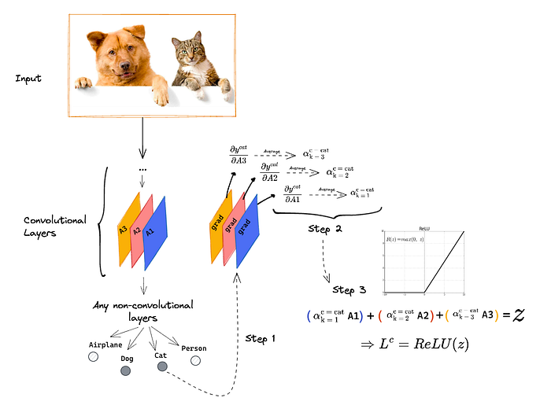
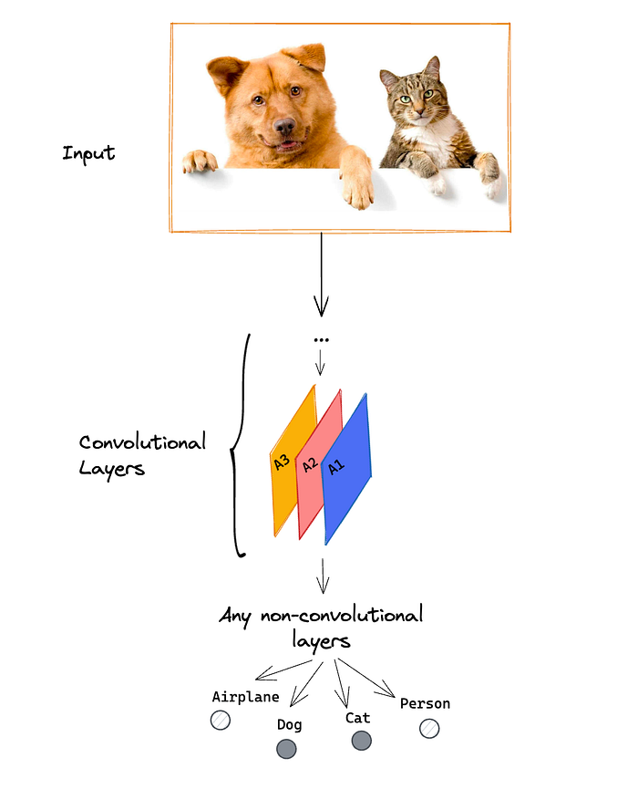
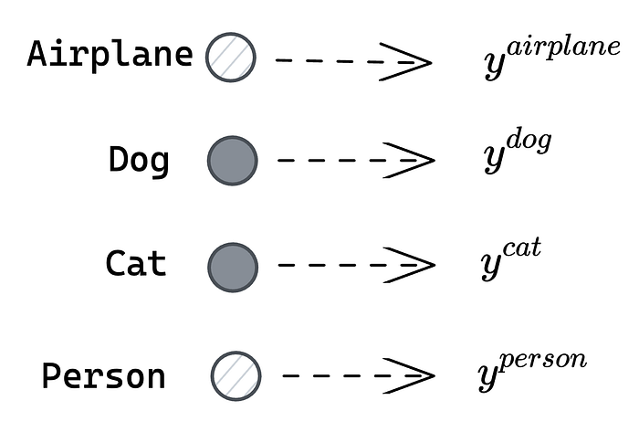
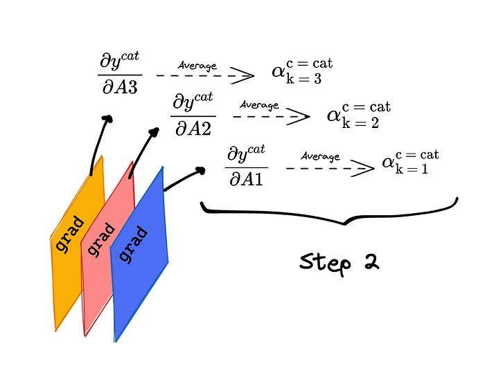

## Introduction

Machine learning has become increasingly accessible in recent years due to three key factors: improved computational efficiency, cheaper storage and memory technologies, and abundant data availability. However, this accessibility raises concerns about algorithmic bias.

While machine learning tools are powerful, they can produce problematic results when trained on biased data. This concern has led to the development of **Explainable AI (XAI)** techniques — methods designed to make algorithmic decision-making more transparent. One such technique is Grad-CAM.

## What is Grad-CAM?

Grad-CAM is a visualization technique that generates heatmaps for image classification tasks. It reveals which regions of an image were most important to a neural network's classification decision. The heatmap highlights the areas the model "focused on" when making its prediction.

## How Grad-CAM Works

The algorithm operates in three steps:

### Step 1: Gradient Calculation

Compute gradients of the **last convolutional layer's feature maps** with respect to a target class. Higher pixel values indicate greater relevance to the final classification decision.

### Step 2: Computing Alphas

Calculate the mean of each gradient matrix. These "alphas" represent the importance of each feature map in determining the classification. Higher alpha values indicate more influential feature maps.

### Step 3: Generating the Heatmap

Compute a weighted linear combination of feature maps using the alpha values, followed by a ReLU activation function. The resulting heatmap is then upsampled to match the original image resolution for visualization.

## Applications

### Detecting Model Bias

One practical application involves validating classifier behavior. Consider a healthcare professional classifier (doctors vs. nurses) that achieved 82% accuracy but was biased. When Grad-CAM was applied, it revealed that the model focused excessively on **facial features** rather than professional attire and work tools — exposing the gender bias in the training data.

### Medical Diagnostics

Grad-CAM has proven valuable in medical imaging. During the COVID-19 pandemic, the technique was used to analyze computed tomography scans. Heatmaps tracked changes in patient lung conditions over time, providing visual confirmation of clinical improvement or deterioration.

## Key Takeaway

Grad-CAM serves as an important tool for understanding neural network decisions in image classification, helping practitioners identify and address algorithmic biases that might otherwise remain hidden despite strong performance metrics.

> Originally published on [Medium](https://medium.com/@arthurfmorais/grad-cam-how-to-build-heatmaps-for-classification-problems-784d728877c0)
