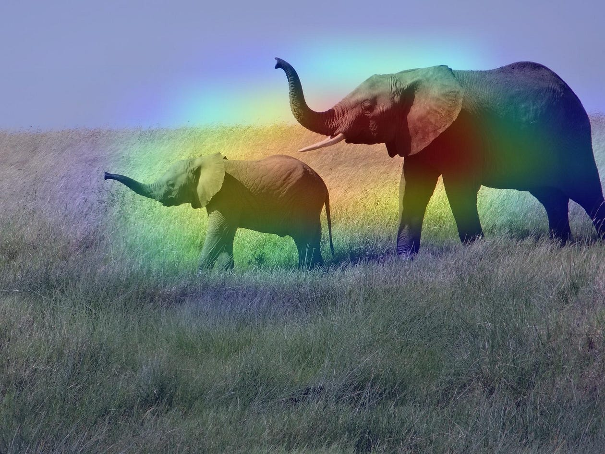
_Figure 1. Example of Grad-CAM application (Source: https://keras.io/examples/vision/grad_cam/)_

It is not news that in recent years it has become easier to develop machine learning algorithms. This hype has three main culprits:

1. Increased efficiency in computer processing.
2. Cheaper storage and memory technologies.
3. Access to a volume of data that would have made artificial intelligence researchers of the last century envious.

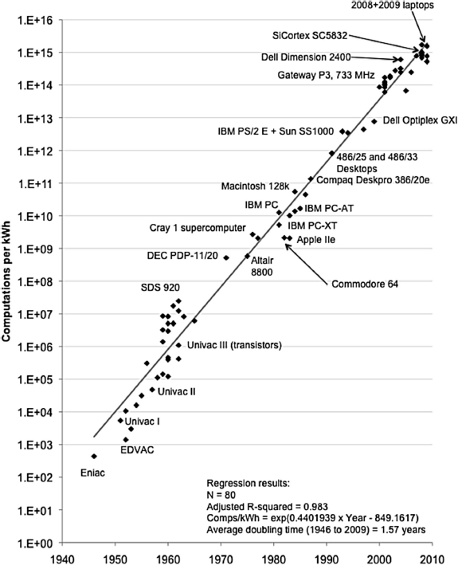
_Figure 2. The efficiency of personal computers roughly doubled every 1.5 years between 1946 and 2009. This fact was essential for the spread of classical machine learning algorithms. (Source: https://ieeexplore.ieee.org/document/5440129)_

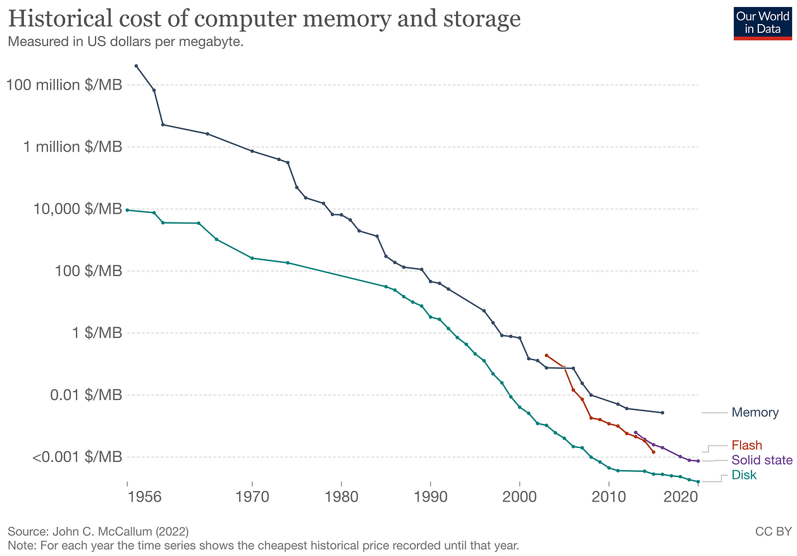
_Figure 3. To develop algorithms that learn efficiently over time, it is necessary to work with large datasets. Access to increasingly cheaper storage technologies has been a decisive factor in the popularization of artificial intelligence in recent years._

In addition, considering the ease of creating content on the internet, we see an avalanche of content being produced (like this one, for example…laughs). Posts with titles like "Create an AI with 2 lines of code" have become increasingly popular (not the case here… apologies to the impatient).

This popularity is VERY important for the dissemination of tools that can drastically change the way computing will evolve in the coming years. However, algorithms that seem miraculous in one context can bring dangerous results in others.

Thus, news about biased algorithms has become increasingly common. This opens up space for a new set of much-needed techniques, techniques that seek to explain the reasons for these algorithms' decision-making. Something like trying to make these "black boxes" a little more transparent. Many researches in this line of reasoning have cited the term XAI (short for Explainable A.I.) as a theoretical framework that brings together various different techniques for this same purpose.

One of these techniques is Grad-CAM, which aims to improve our understanding of decision-making in image classification problems.

## How Grad-CAM works

Let's suppose that we have a convolutional neural network (CNN) trained to classify an image into the categories of plane, dog, cat, or person.

> To learn more about how a neural network is organized, I recommend this [playlist here](https://www.3blue1brown.com/topics/neural-networks). Convolutional neural networks are a class of artificial neural networks. To learn more about CNNs, see this [video here](https://www.youtube.com/watch?v=zAfBy74c2AI).

_Figure 4. Grad-CAM can be applied to a pre-trained convolutional network for a classification task, regardless of the network architecture and the number of possible classifications._

If the network has been well trained, the Dog and Cat classes will receive high values, indicating that these classes are probably present in the image. Grad-CAM produces a heatmap for each possible classification.

Now a little bit of formalism so that we can describe the algorithm's steps and how it generates a heatmap at the end of the process. In the end, the heatmap is represented by a two-dimensional matrix, analogous to the model's input, that is:

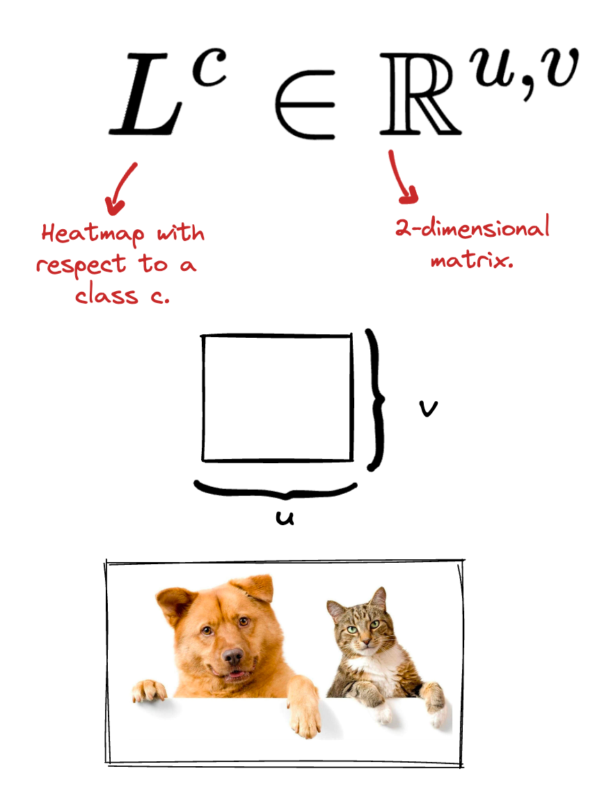
_Figure 5. The output of Grad-CAM is a heat map of dimensions (u, v). These dimensions are not necessarily the same as those of the original image._

In addition to the naming convention to define what a heatmap is, it is necessary to define how we will refer to the score that the CNN assigns to each of the possible classes.

_Figure 6. For each possible class, there is a corresponding numerical value for the probability of that class being present in the image. In this context, y represents this numerical value, which can be a probability._

Let's suppose we are looking for the heatmap for the classification of this image into a cat. That is, which region of the original image was most significant for the neural network to determine that the image contains a cat?

### Step 1: Gradient calculation

For this, it is necessary to first obtain the gradients of each of the channels of the last convolutional layer (A1, A2, and A3) with respect to the desired class (cat).

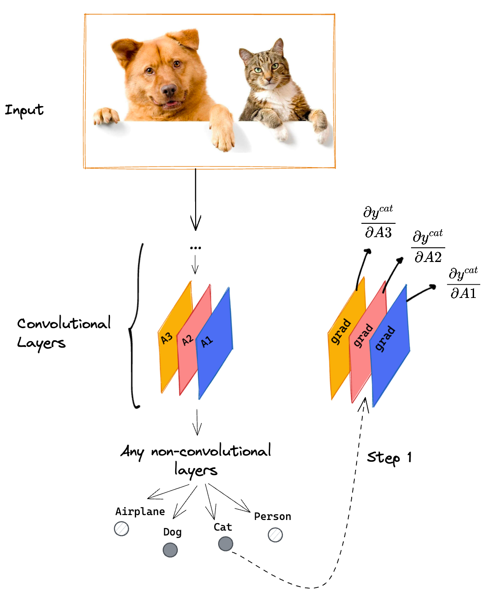
_Figure 7. Step 1: Calculation of gradients of the feature maps from the last convolutional layer of the trained network with respect to a given class._

The intuition behind the result of this process is that these generated matrices will have pixels with higher values the more relevant these regions are to determine the final value that the CNN assigned to this class (cat).

The output of this step is a matrix of dimensions (u, v, k). In this particular example, k = 3.

### Step 2: Alphas

For each of the gradients calculated in the previous step, we obtain the mean of each of the 2-dimensional matrices.

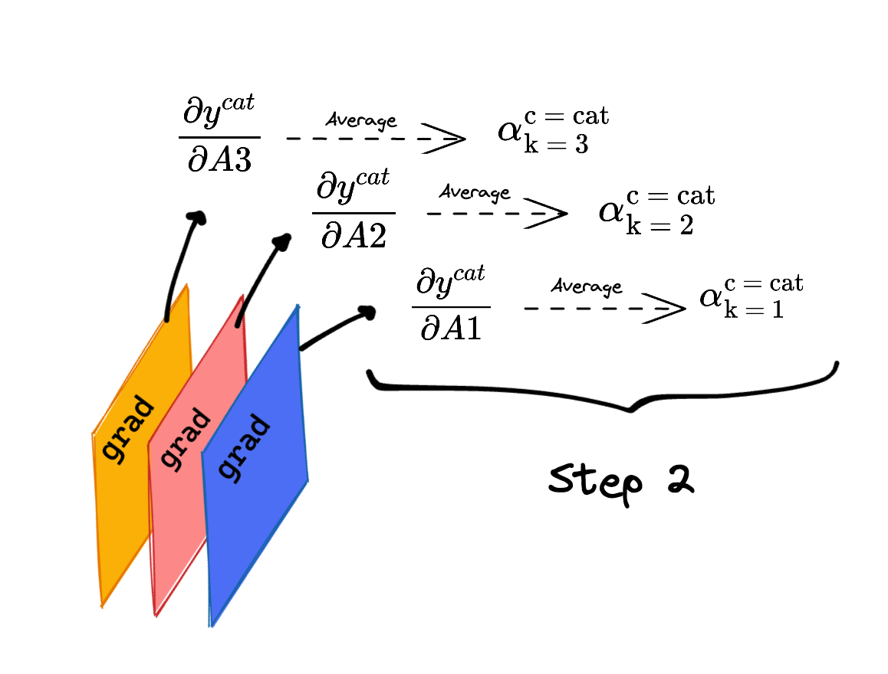
_Figure 8. Step 2: Apply arithmetic mean to each of the gradients resulting from step 1._

Thinking about the intuition behind this step, instead of looking for pixel-by-pixel relevance for a given class as we did in step 1, we transform it into relevance for each of the maps (A1, A2, and A3).

Thus, each of these "alphas" represents how important each of the maps was in making the decision to classify the image as containing a cat. The higher the alpha, the more important the corresponding map was in making the decision for a given class.

Since the output of the previous step was a matrix (u, v, k), the output of this step has dimensions (1, 1, k).

### Step 3: Heatmap

Since the output of the previous step is scalar values, for each of the maps A1, A2, and A3, we can perform a linear combination of these factors and their corresponding maps.

As an additional step, the Grad-CAM algorithm applies a ReLU function to the result of this operation.

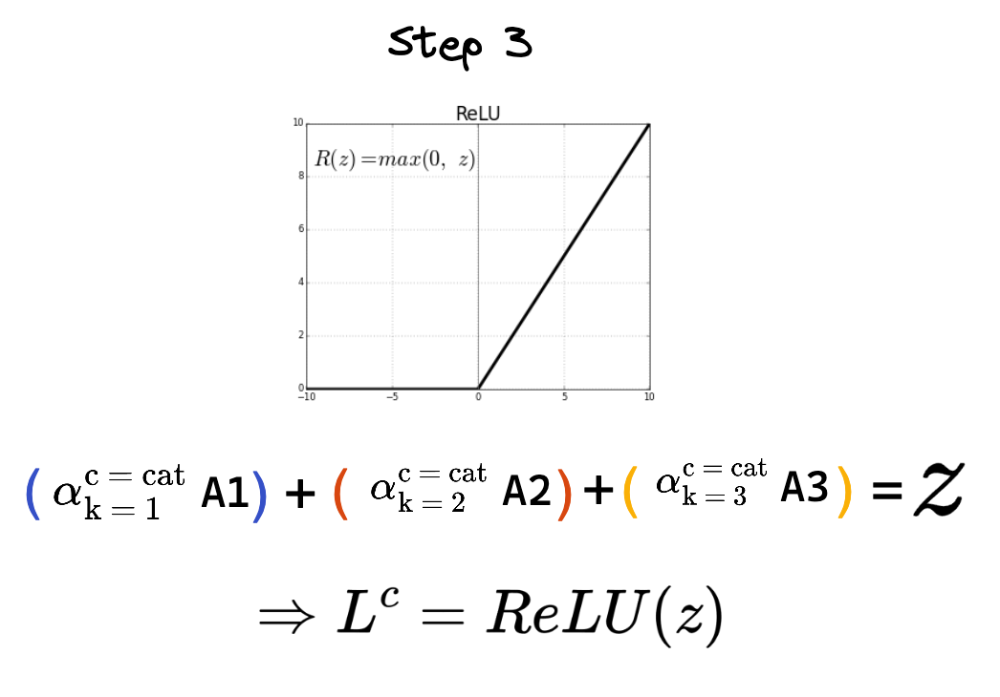
_Figure 9. Step 3: The final heatmap is obtained using the alphas from step 2 as weights of the feature maps from the last convolutional layer of the trained network._

The output of this step has the same dimensions as the input of step 1, that is, a matrix (u, v, k). Since the feature maps of the last convolutional layer usually have much lower resolution than the original image, it is necessary to redefine the final resolution of the heatmap.

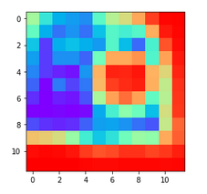
_Figure 10. Example of output from step 3: The most reddish regions indicate pixels with a relatively higher value compared to the other pixels present in the same image._

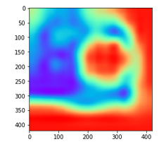
_Figure 11. Example of output from step 3 after resolution adjustment. As it is necessary to overlay the heatmap with the original image, both must have the same dimensions._

_Figure 12. The 3 steps of the Grad-CAM algorithm applied to a pre-trained convolutional neural network._

Finally, the obtained heatmap can be placed on top of the original image. The highlighted regions were the most important regions for classifying the input image as an image containing a cat.

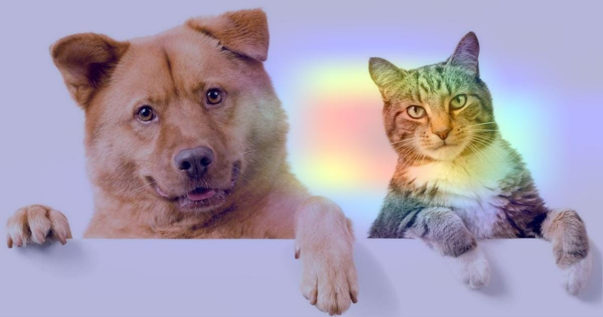
_Figure 13. After adjusting the resolution of the heatmap obtained after the last step of the algorithm, the heatmap is overlaid on the original image. The highlighted regions were the most relevant for the decision-making of the previously trained algorithm (Source: https://keras.io/examples/vision/grad_cam/)._

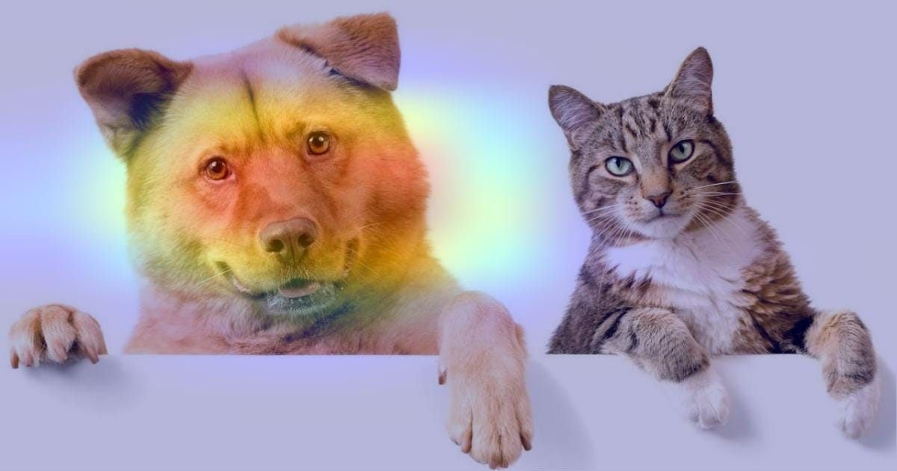
_Figure 14. The Grad-CAM algorithm generates a heatmap for each of the possible classes defined during the model training. The highlighted regions indicate the areas of greatest importance for determining that the image contains a dog (Source: https://keras.io/examples/vision/grad_cam/)._

In none of the previous steps should the class to be used necessarily be cat. Similarly, we could want to highlight the areas that the algorithm considered relevant to make the decision to classify the image as a dog. To do this, just replace the desired class of the final heatmap in steps 1, 2, and 3 of the algorithm.

## Applications

There are classification problems where the distribution of the training data must be carefully analyzed. Grad-CAM can be used as a validator for the results obtained by the model.

For example, consider a classifier of healthcare professionals. In this context, there are only two possible classes: Doctors or nurses. The training dataset was actually biased (78% of doctor images were men and 93% of nurse images were women) and therefore generated a model that, even with high accuracy (82%), contained a bias.

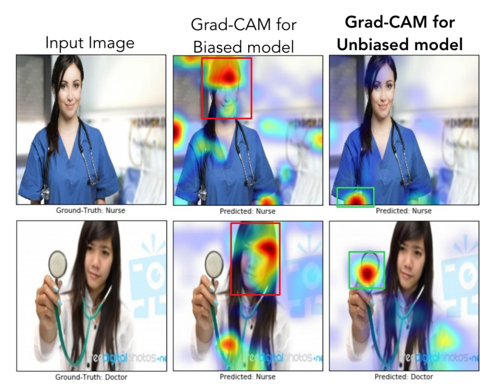
_Figure 15. Example of Grad-CAM applied to a biased model, compared to an unbiased model, for the classification of healthcare professionals (Source: https://arxiv.org/abs/1610.02391)._

When applying the Grad-CAM technique to two different images, it was noticed that the biased model (second column of the image above) was "looking" more at the professional's face than at their clothes and work tools.

This type of analysis is becoming increasingly relevant recently, where we have more and more classification algorithms in everyday applications.

In addition to such simple classification, Grad-CAM can be applied to image diagnostic classifiers. A series of works emerged in this direction during the recent Coronavirus pandemic.

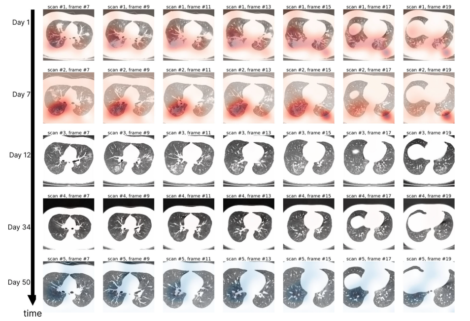
_Figure 16. Grad-CAM applied to different computed tomography images of a single patient's lung over 50 days. The generated heatmaps suggest an improvement in the patient's clinical condition (Source: https://www.nature.com/articles/s41746-020-00369-1)_

I hope you enjoyed learning about the idea of Grad-CAM and some possible applications of this technique 🔚
