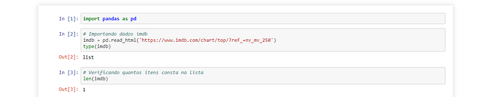
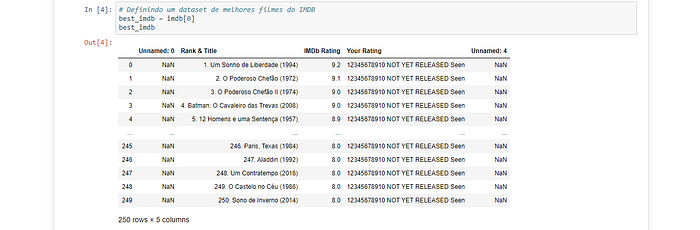
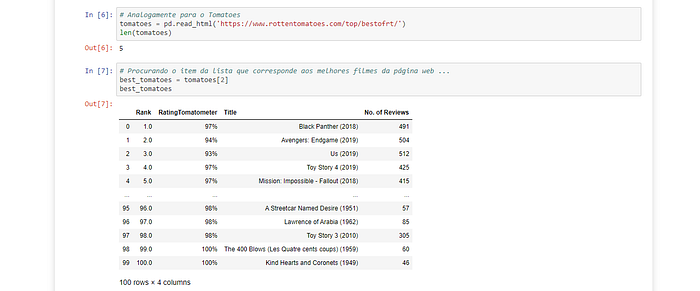
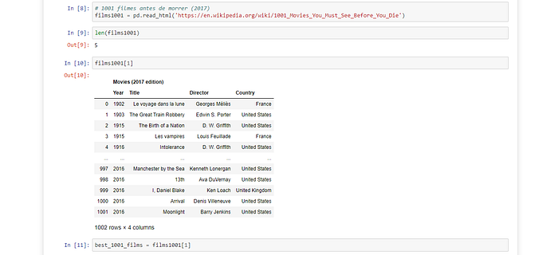
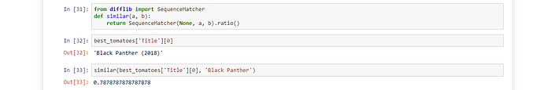
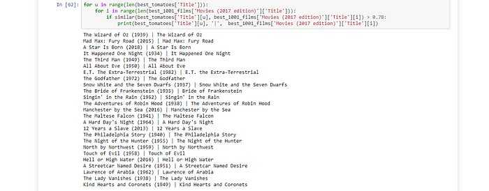

## The problem

How many times have you wasted hours picking a movie — and ended up disappointed? Instead of relying on Netflix's recommendation algorithm, I decided to use Python to build my own list.

## The technical approach

While taking a Python Pandas for Data Science course at Alura, I came across the `pandas.read_html()` function. This function automatically extracts tables from web pages and converts them into DataFrames — perfect for aggregating movie data from multiple sources.

## Data sources

The project combines three well-known rankings:

1. **IMDb Top 250** — The highest-rated films according to IMDb users
2. **Rotten Tomatoes** — Critically acclaimed films
3. **1001 Movies You Must See Before You Die** — A classic list available on Wikipedia

## Technical challenge: title matching

Each site formats titles differently. IMDb includes ranking numbers; Rotten Tomatoes appends release years. Simple string matching didn't work, so I implemented a **similarity score** with a threshold above 0.78 to confirm matches.

## Results and limitations

The analysis successfully identified films appearing in both Rotten Tomatoes and the 1001 films list. Integrating IMDb data was harder: titles were in Portuguese, and translation APIs didn't produce reliable results.

## Conclusion

The goal was achieved: explore film discovery techniques and showcase useful Pandas functions. The project is available on [GitHub](https://github.com/ArthurMor4is/ListaDeFilmes_python_project) — feel free to extend it with other ranking sources!

> Originally published on [Medium](https://medium.com/@arthurfmorais/qual-filme-assistir-1edb9beaa840)
