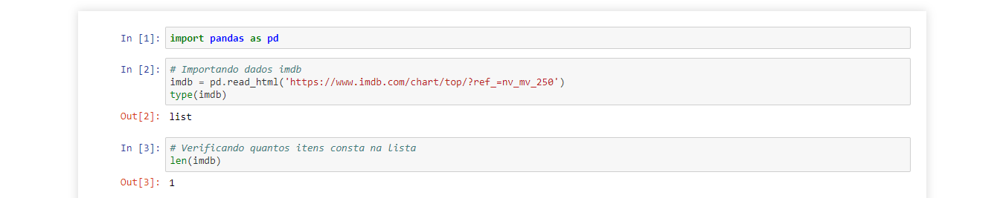
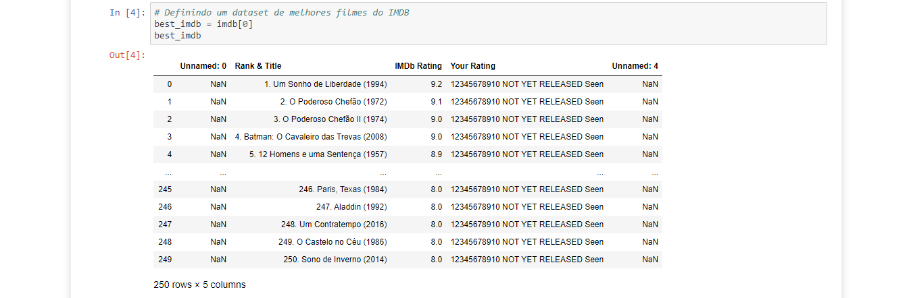
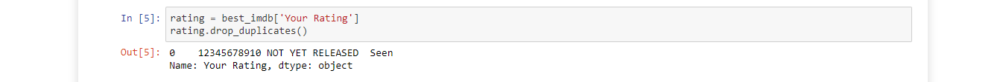
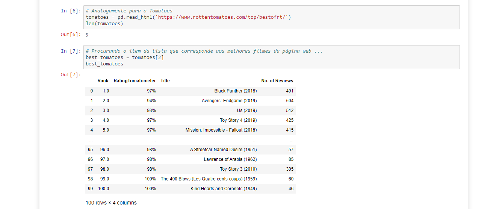
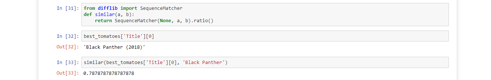
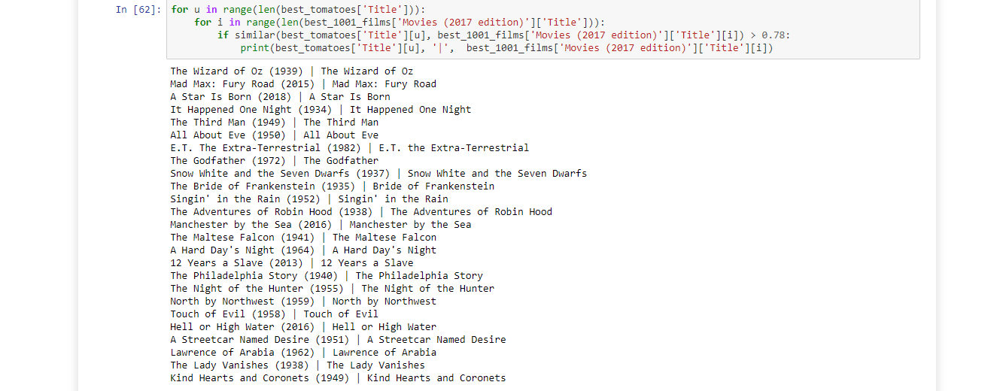

How I used Python to build a new movie list

Who hasn't wasted hours picking a movie — only to end up disappointed? I'm not
going to get into the merits of recommendation algorithms used by streaming
services like Netflix. My goal here is to describe how we can use rankings from
a few websites (even if they change over time) to find recommendations for new
films worth watching.

While taking Alura's online course — Introduction to Python Pandas, part of
their Data Science track — I came across a very useful function in the Pandas
library: `pandas.read_html`. It scrapes tables from a web page and returns them
as a list of DataFrames. Starting from that function (and my desire to make good
use of the vacation time my university grants me) I decided to build a movie
recommendation notebook.

I started by looking up the top-rated films on IMDb, available at
[this link](https://www.imdb.com/chart/top/?ref_=nv_mv_250). To get my first
DataFrame I checked whether the function returned more than one table — there
might be extra tables elsewhere on the page:

Great — as expected, we only got one DataFrame. Let's rename it and take a look
at how IMDb structured it:

I then checked whether the user-rating column actually had the same value filled
in for every film.

Unfortunately, as the preview already suggested, none of the films had the
ratings I had previously filled in.

Moving on, I looked for another well-regarded source for worldwide film
rankings: Rotten Tomatoes. I pulled the top-rated films from
[this link](https://www.rottentomatoes.com/top/bestofrt/) using the same
approach.

In this case, the page containing the best-films list also had other tables I
didn't need, so I had to test them one by one in the notebook.

Finally, to refine the recommendation even further, I looked into the famous
list of 1001 movies you must see before you die — the result of a series of
books with that rather daunting title. Fortunately, I didn't have to hunt down a
pirated PDF: one of those lists is available on
[Wikipedia](https://en.wikipedia.org/wiki/1001_Movies_You_Must_See_Before_You_Die).

Just like with Rotten Tomatoes, I had to figure out which table on the page was
the one I needed.

At this point my goal was to get a list of films that ranked highly on both IMDb
and Rotten Tomatoes and also appeared in the 1001 films list. The first problem
I ran into was title formatting: each DataFrame uses a different convention. The
IMDb list includes a ranking number before the film title in the 'Rank & Title'
column; Rotten Tomatoes appends the release year after the title in the 'Title'
column. A simple string comparison wasn't going to cut it.

But that's what Stack Overflow is for :)

In [this thread](https://stackoverflow.com/questions/17388213/find-the-similarity-metric-between-two-strings)
I found a string similarity metric. I ran a quick test with the top-ranked film
in the Rotten Tomatoes DataFrame to see whether it would actually be useful:

Based on that, I decided to use a similarity score above 0.78 to consider two
titles a match across different DataFrames.

I then got a list of films appearing in both Rotten Tomatoes and the 1001 films
list simultaneously. I printed them out just to make sure there were no false
positives:

At this point I had a solid list of films, but IMDb was still missing.

And here's where a problem came up: the IMDb film titles were in Portuguese, not
English. I looked into ways to work around it, but the tests I ran using
[this Google Translate API](https://pypi.org/project/googletrans/) weren't
reliable enough — movie title translations are rarely literal :(

All things considered, I believe I achieved my original goal: exploring how to
build a new movie list and showcasing some useful Pandas functions along the
way. I'm happy with this for a first post. You can take this notebook and extend
it with other ranking sources of your choosing :)

